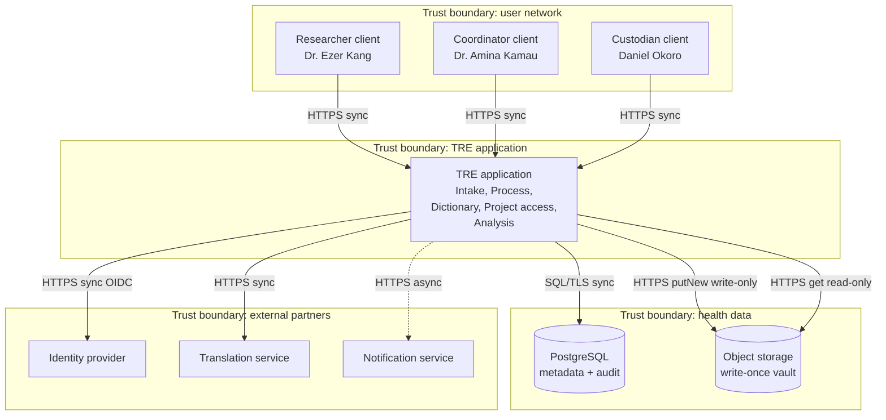
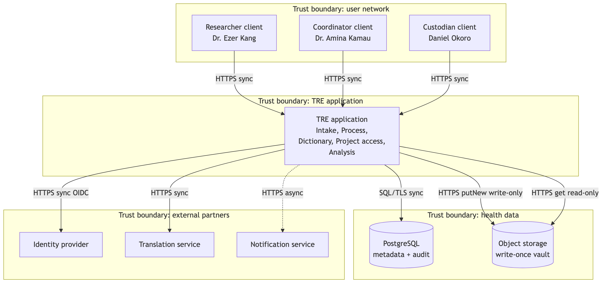

# B2. Architecture diagram

**Caption:** This architecture supports PP-1, PP-2, PP-3, PP-4, and PP-5. Solid arrows are synchronous; the dotted arrow is async notification.

Legend: box = client, service, or external system. Cylinder = data store. Dashed box = trust boundary.

Modules match A5 clusters. External systems match A1. Every trust-boundary crossing has a protocol label. Authentication for the OIDC arrow and authorization for roles are in B1 section 5.
