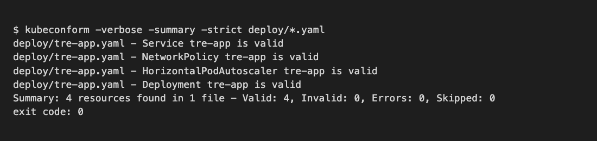

# C. Kubernetes manifest

**Caption:** This manifest supports PP-1 through PP-5 by deploying the one TRE application from B2 (intake, process, project access, analysis).

A Kubernetes manifest is YAML that states the desired setup: image, replica count, CPU and memory, and how traffic reaches the pods. This project points at `tre-team/app:0.1.0`. Files are in `deploy/tre-app.yaml`. `kubeconform` validates them offline.

## How it scales and how it is secured

Deployment starts at 2 replicas. HorizontalPodAutoscaler grows to 6 when average CPU stays above 70 percent. Service type is ClusterIP. NetworkPolicy allows inbound 8080 only, and outbound DNS, PostgreSQL 5432, and HTTPS 443 for identity, object storage, translation, and notification. Secrets `tre-db` and `tre-api` supply the database password and translation key. `runAsNonRoot: true` keeps the process off root. Soft WORM is enforced in the application; the NetworkPolicy still limits which ports the pods may use to reach the vault over 443.

