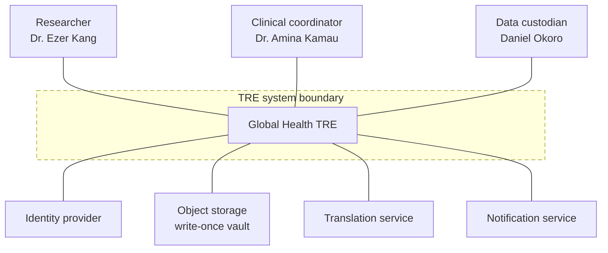
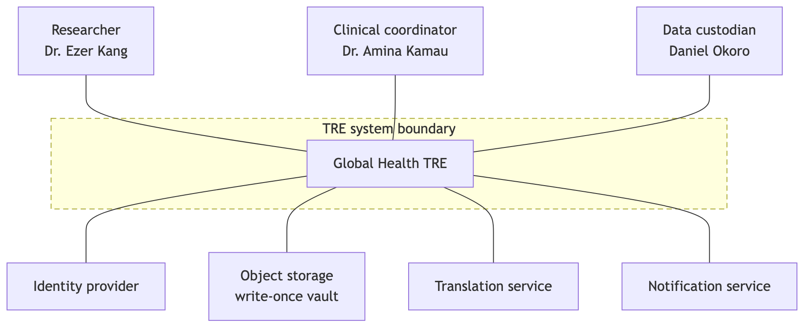

# A1. Context diagram

**Caption:** This context diagram supports PP-1, PP-2, PP-3, PP-4, and PP-5 by showing the TRE between the three personas and the external systems it uses.

## Boundary justification

The TRE builds upload audit, project-scoped access, de-identification into a new analysis object, spreadsheet-style explore, charts, and gated download records. Sign-in, the vault, machine translation, and notification delivery are integrated. We chose to build the approval and audit rules; we chose to integrate the identity provider instead of storing passwords ourselves.
