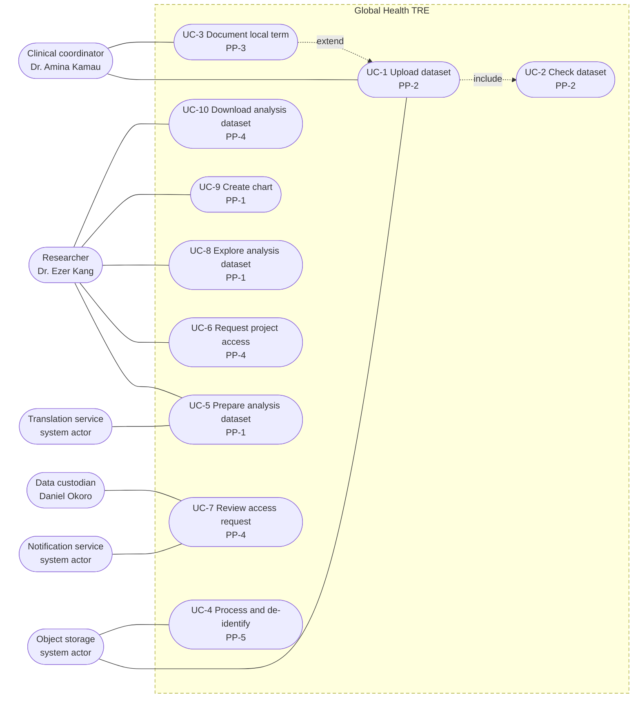
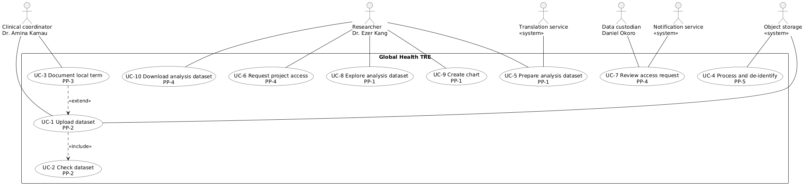

# A2. Use case diagram

**Caption:** This use case diagram supports PP-1, PP-2, PP-3, PP-4, and PP-5. Each use case is tagged with its PP-ID.

PlantUML source: `A2-use-cases.puml`.

Three human actors and three system actors. **«include»:** UC-1 → UC-2 (check always runs). **«extend»:** UC-3 → UC-1 (local term only when present). Ten use cases (within 6–10), each tagged with a PP-ID.
