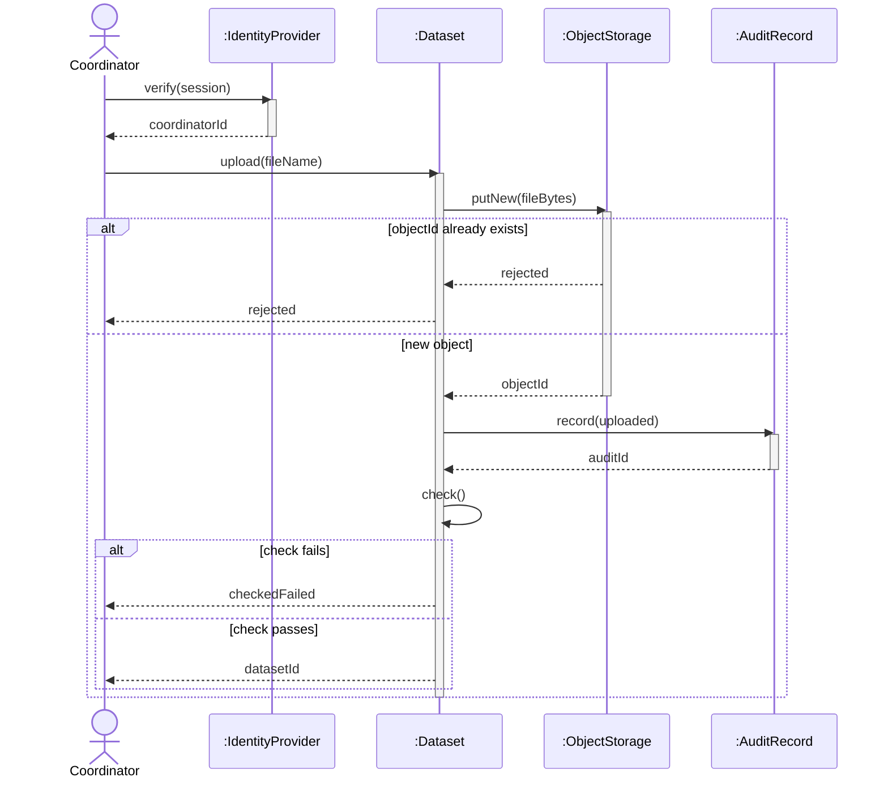
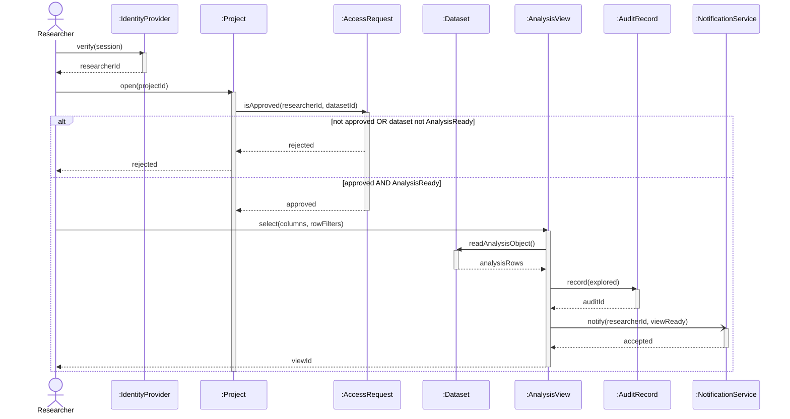
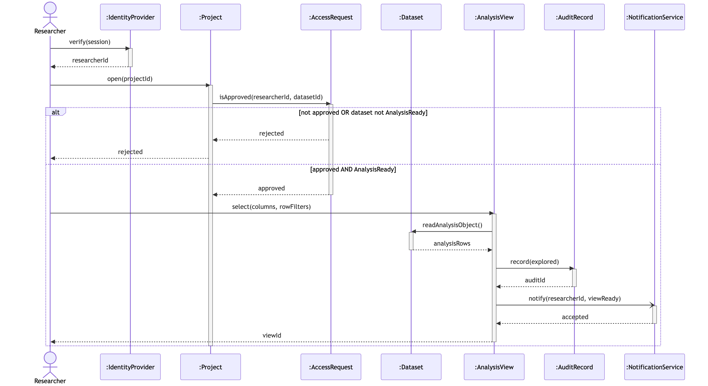

# A4. Sequence diagrams

One sequence per textual use case in A3. Lifelines use `:ClassName`. Filled arrowhead = synchronous. Open arrowhead = asynchronous. Dashed = return.

## UC-1 Upload dataset

**Caption:** This sequence supports PP-2: verify user, write-once store, upload audit, then included check.

External system: `:ObjectStorage` and `:IdentityProvider` from the context diagram. Guards are in brackets inside `alt`.

## UC-8 Explore analysis dataset

**Caption:** This sequence supports PP-1 after project approval: verify, confirm access, build a column/row view, audit, async notify.

`notify` uses an open arrowhead (asynchronous). Returns are dashed. Explore never writes to object storage.
