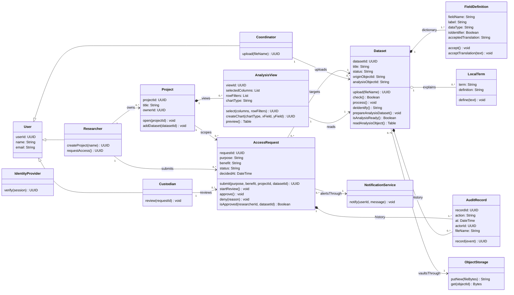

# A5. Domain class diagram

**Caption:** This class diagram supports PP-1, PP-2, PP-3, PP-4, and PP-5. Eleven domain classes (within 6–12) plus three external system classes required by A4.

**Domain classes (11):** User, Researcher, Coordinator, Custodian, Project, Dataset, FieldDefinition, LocalTerm, AccessRequest, AnalysisView, AuditRecord.  
**External system classes (for A4):** IdentityProvider, ObjectStorage, NotificationService.

**Generalization:** Researcher, Coordinator, Custodian specialize User.  
**Composition:** FieldDefinition dictionary and AuditRecord history die with their whole.  
**Aggregation:** LocalTerm can be reused across datasets from the same site.

Soft WORM: `ObjectStorage.putNew` only; Dataset keeps separate `originObjectId` and `analysisObjectId`. Charts use `AnalysisView.createChart`.

Every A4 message is an operation on the receiving class: `verify`, `upload`, `putNew`, `record`, `check`, `open`, `isApproved`, `select`, `readAnalysisObject`, `notify`.
