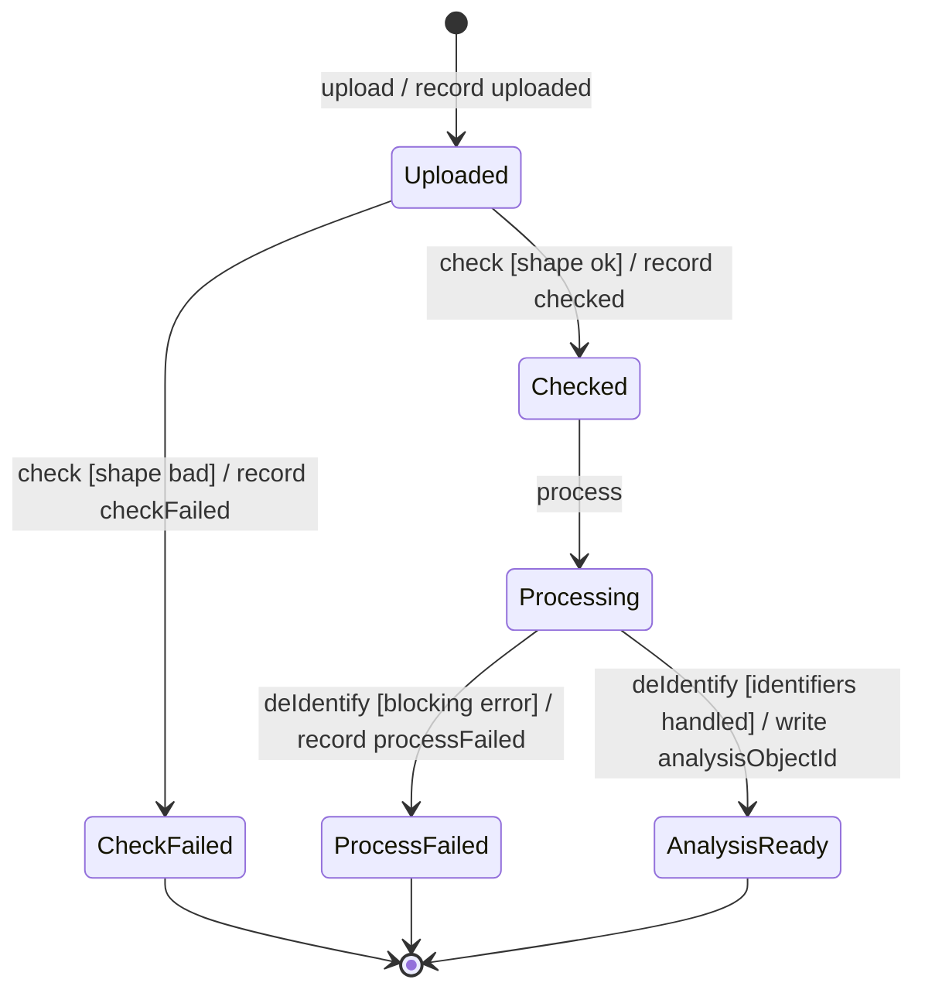

# A6. State machine diagram

**Caption:** This state machine supports PP-2 and PP-5. The entity is Dataset, from write-once upload through de-identified AnalysisReady.

Six states: Uploaded, Checked, CheckFailed, Processing, AnalysisReady, ProcessFailed. Initial and final pseudostates included. Failure paths: CheckFailed and ProcessFailed. Guards and actions appear on check and deIdentify.

There is no transition that overwrites `originObjectId`. AnalysisReady writes a **new** `analysisObjectId`.

| Event | Also appears in |
|---|---|
| upload | A4 UC-1, A7 |
| check | A4 UC-1, A7 |
| process | A7 |
| deIdentify | A7 |

Explore requires AnalysisReady and an approved AccessRequest (`isApproved` in A4 UC-8).
