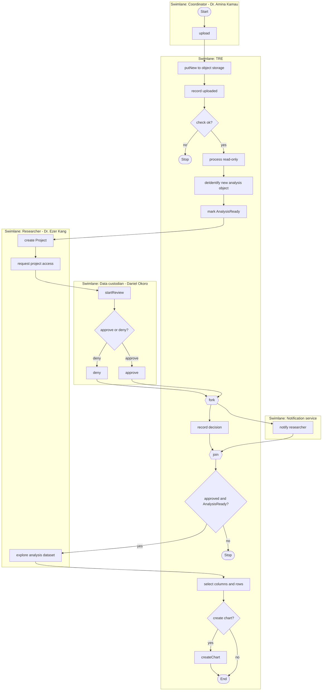
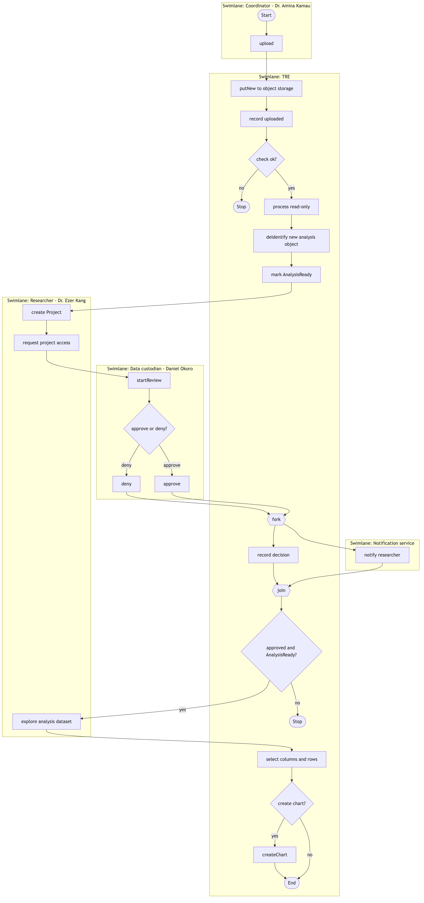

# A7. Activity diagram

**Caption:** This activity supports the walkthrough upload → audit → analyze under a project (PP-2, PP-5, PP-4, PP-1).

Swimlanes map to A1 actors/systems. Decisions use guards. After the custodian decides, recording the decision and notifying the researcher run in parallel (fork/join). Explore and optional chart run only when access is approved and the dataset is AnalysisReady.
